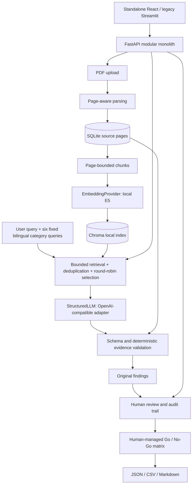

# TenderCite

**Evidence-grounded AI for public procurement documents**

TenderCite turns text-based tender PDFs into source-linked findings that a human can review
and use in a Go / No-Go matrix. Every claimed citation is checked against a stored document,
page and text passage. A valid quotation does **not** prove the model's interpretation is correct.

**Status:** unreleased development work built on v0.1. The complete workflow is implemented
and tested with deterministic model doubles. The first real E5 synthetic retrieval evaluation is
measured; live LLM evaluation and release review remain open. This repository is **not yet
declared v1.0.0**. See [release checks](docs/release-check.md).

## What works

- Multi-PDF upload, page-aware pypdf parsing, bounded chunks and exact source offsets.
- SQLite persistence and duplicate-upload detection by SHA-256.
- Replaceable local embeddings (default `intfloat/multilingual-e5-small`) and persistent Chroma search.
- Document-scoped retrieval with source metadata; idempotent reindexing.
- Explicit bilingual analysis query plan, bounded category context and retrieval audit metadata.
- OpenAI-compatible structured extraction with Pydantic validation and per-citation checks.
- Explicit VERIFIED_QUOTE / INVALID_QUOTE / MISSING_EVIDENCE states.
- Confirm, modify or reject findings while preserving original AI output and review history.
- Human-managed Go / No-Go statuses, defaulting to CLARIFICATION_NEEDED.
- Independent React workspace in `web/` for documents, manual intake, reviews, assessments, snapshot import, manual skill mapping and recorded capability coverage.
- Native manual freelancer/company profiles at `/profiles`, independent of workforce snapshots, with explicit revision-checked saves and unverified skill declarations.
- Native manual opportunities at `/opportunities`: local external project/tender references, skill labels, date-only deadlines and revision-checked saves; no source fetching or matching.
- JSON, CSV and Markdown exports; legacy Streamlit UI; FastAPI/OpenAPI.
- Synthetic evaluation corpus, offline tests, hashed dependency locks, Docker and CI definitions.

## Architecture



No agent framework, microservices or remote Chroma server is required. See
[architecture](docs/architecture.md) and [data models](docs/data-models.md).

## Standalone React quick start

TenderCite runs independently of Team Capacity Engine and PostgreSQL. With the existing Python
environment installed and Node.js **24.x**, use two terminals from this repository:

```powershell
# Terminal 1: local synthetic backend, no retrieval/model access.
$env:TENDERCITE_DATA_DIR = "data/curated/react-synthetic"
$env:TENDERCITE_RETRIEVAL_ENABLED = "false"
.\.venv\Scripts\python.exe -m uvicorn tendercite.main:app --host 127.0.0.1 --port 8001
# Terminal 2:
npm --prefix web ci
$env:TENDERCITE_PROXY_TARGET = "http://127.0.0.1:8001"
npm --prefix web run dev
```

```sh
# Terminal 1:
TENDERCITE_DATA_DIR=data/curated/react-synthetic TENDERCITE_RETRIEVAL_ENABLED=false .venv/bin/python -m uvicorn tendercite.main:app --host 127.0.0.1 --port 8001
# Terminal 2:
npm --prefix web ci
TENDERCITE_PROXY_TARGET=http://127.0.0.1:8001 npm --prefix web run dev
```

Open **http://127.0.0.1:5174**. See [standalone workspace setup](docs/web-workspace.md) for fresh
Python installation, optional synthetic snapshot flag, all migrated workflows, browser tests and
remaining CLI-only functions. The React app retains `/tenders` deep links and uses one explicit
same-origin development proxy. No server/model calls are started automatically beyond inspection
queries; writes remain explicit. Production hosting/authentication are separate work.

Workforce snapshot generation stays in the optional Team Capacity Engine application or another
compatible producer. [Native profiles](docs/integrations/native-profiles.md) can instead be created
and edited entirely within TenderCite, without a producer or snapshot. They are separate manual
declarations and do not yet participate in matching. Snapshot workflows use the existing import
contract without requiring a workforce server. [Native opportunities](docs/integrations/native-opportunities.md)
can be created and edited independently of profiles, documents and analyses. They are unverified
external references, not job listings published by TenderCite. Bounded snapshot selection and explicit mapping
draft/approval are available in
[Skill Mapping](docs/integrations/manual-skill-mapping-ui.md), behind the existing local mapping API flag.
Full snapshot history/export and mapping revision/revocation/history remain CLI-only.
The [capability assessment report API](docs/integrations/capability-report-http.md) exposes the
existing persisted matching report behind a separate local opt-in. The
[Capability Matching view](docs/integrations/capability-matching-ui.md) supports explicit finding
selection and private coverage inspection without qualification or capacity inference.
Model-based search/analysis and exports remain
in the existing backend/legacy UI. [Migration provenance](web/MIGRATION.md) records the original
implementation, tests and limited adaptations; its source repository remains an untouched fallback.

## Legacy Streamlit quick start (Python 3.12, Linux CPU)

`frontend/app.py` remains unchanged. It is the legacy client, not the new `web/` React package.
Its existing search/analysis/export workflows remain available:

```bash
git clone https://github.com/nak224/tendercite.git
cd tendercite
python -m pip install uv==0.12.19
uv venv .venv
uv pip install --python .venv/bin/python --torch-backend cpu --require-hashes -r requirements-dev.lock
uv pip install --python .venv/bin/python --no-deps -e .
source .venv/bin/activate
uvicorn tendercite.main:app --host 127.0.0.1 --port 8000
# In a second terminal, activate the same environment:
streamlit run frontend/app.py --server.address=127.0.0.1
```

The first text upload/search downloads E5 model files from Hugging Face. The tested default
`TENDERCITE_EMBEDDING_REVISION` is `614241f622f53c4eeff9890bdc4f31cfecc418b3`;
it remains configurable. Reindex after changing model or revision. Allow sufficient
network access and a writable Hugging Face cache; set `HF_HOME` if necessary. If unavailable,
the source remains stored and upload returns 503: fix model access and retry upload or
`POST /api/v1/documents/{id}/index`. To work on ingestion alone, explicitly set
`TENDERCITE_RETRIEVAL_ENABLED=false` before starting the API.

For other platforms, install `.[dev,retrieval,ui]` using your platform's PyTorch instructions;
the checked-in locks target Python 3.12 Linux CPU. Revalidate on other platforms.

### Configure structured analysis

```bash
export TENDERCITE_LLM_BASE_URL=http://localhost:11434/v1
export TENDERCITE_LLM_MODEL=your-served-model
# Set TENDERCITE_LLM_API_KEY securely if your provider requires it.
```

Restart the API after changing settings. The server must support OpenAI-compatible
`/chat/completions` and JSON-schema output; compatibility with every Ollama/vLLM/LM Studio
version is not claimed. No model server is bundled. The API reads `.env`; the Streamlit
API URL must be exported as `TENDERCITE_API_URL` when overriding its default.

Analysis sends selected retrieved passages to the configured provider. Review its privacy,
retention and model-license terms first. Offline tests do not need model downloads or paid APIs.

### Legacy Streamlit walkthrough

1. Import PDFs in **Documents**; inspect page/chunk counts.
2. Use **Search** and select source documents in the sidebar.
3. In **Analysis & review**, choose a focus and explicitly permit sending passages.
4. Inspect quotes and source pages; confirm, modify or reject each finding with a comment.
5. In **Go / No-Go**, record bidder facts, status and rationale.
6. Download **Export** results. Unreviewed/rejected findings remain explicitly labeled.

## Tests and evaluation

```bash
pytest
ruff check .
ruff format --check .
# With a working real embedding model and running API:
python -m evaluation.run --output /tmp/retrieval-evaluation.json
# Additionally uses the configured LLM, with synthetic text only:
python -m evaluation.run --analysis --output /tmp/full-evaluation.json
```

Tests exercise real SQLite/Chroma and the API/UI with deterministic embedding/LLM doubles.
The [14-case English/German evaluation](evaluation/README.md) uses multi-chunk pages with
procurement distractors and separate SECURITY/PRIVACY cases. It distinguishes `page_hit_at_k`
from `source_span_hit_at_k` (the retrieved chunk must contain the gold quote), alongside exact
extraction source-span/type precision/recall/F1 and evidence rates. Offline regressions test
category coverage and citation boundaries; they do not establish real-model retrieval quality
or broad tender-analysis accuracy.

The [real E5 evaluation](docs/evaluation/multilingual-e5-synthetic-tender-3.md) measured
source-span Hit@1 of 6/7 and Hit@3/@5 of 7/7 in each language. At a 12-chunk budget, the category
plan covered 11/14 requirements (11 unique chunks), versus 12/14 for the broad-query baseline.
The report includes the misses, raw results, CPU timings and reproduction steps. These 14
synthetic cases do not establish real-tender accuracy or exhaustive extraction.

The [TED evaluation acquisition pilot](docs/evaluation/ted-pilot.md) adds a bounded official
Search API client and `python -m evaluation.acquire_ted` CLI. Live search obtained 20 German
competition-notice metadata records, with 17 provisional candidates. PDF/XML downloads were
blocked by TED's WAF; parsing and the suitable-document shortlist remain pending. This is
evaluation preparation for [issue #4](https://github.com/nak224/tendercite/issues/4), with no
real-tender scores or automatic discovery/analysis claim. Downloaded files stay outside Git.

For permitted manual downloads, the evaluation-only
[`python -m evaluation.import_pdfs` workflow](docs/evaluation/real-pdf-import.md) registers local
PDFs with unchanged bytes, SHA-256 deduplication, tender grouping and a provenance/validation
manifest. Missing or unverified source and rights information stays explicitly flagged. Tests use
self-generated PDFs; genuine documents, rights review and manual annotation remain pending.

The [human annotation workflow](docs/evaluation/real-tender-annotations.md) adds a versioned
JSON schema and `python -m evaluation.validate_annotations` CLI. It checks source hashes, tender
association and exact page quotes, reports exclusions, and exports only independently reviewed
VERIFIED labels with deterministic tender-level train/development/held-out splits. The runnable
example is synthetic; real human labels and model evaluation remain pending.

The [external EU Tenders QA pilot](docs/evaluation/external-benchmark-pilot.md) adds an optional
bounded Hugging Face acquisition/validation CLI. The pinned dataset has 97 English QA records;
one 12-question family yielded four PDFs, three parseable, with nine usable document-reference
cases. [Exploratory document retrieval](docs/evaluation/external-document-retrieval.md) ran real
pinned E5/Chroma on those nine cases: any-document Hit@1 and all-documents Hit@2 were 9/9.
Every eligible label references the same specifications PDF; these candidate-label scores establish
neither source-span correctness nor general retrieval quality. Original spans and independent human
gold remain unavailable. Raw PDFs/QA/results stay ignored; no LLM evaluation has run.

## External QA source-span review

The [human source-span workflow](docs/evaluation/external-qa-source-spans.md) prepares a separate
versioned review template and exact numbered page-text exports from the existing acquisition
and document-retrieval outputs. Offline validation checks hashes, original references, verbatim
quotes, duplicates and independent reviewer aliases; every referenced document needs VERIFIED
support before a question is evidence-complete. The local pilot contains nine questions and
100 exported pages, with zero human annotations so far. Source files remain ignored; no new
retrieval scores or requirement-extraction labels are produced.

The [recorded source-span evaluator](docs/evaluation/external-source-span-retrieval.md) adds
offline chunk-rank metrics and size/boundary diagnostics using saved E5 results. It requires
a hash-matching COMPLETE human-review report and freshly validated VERIFIED quotes. Execution
here is blocked by missing reviewed inputs; no source-span scores are claimed. The guide has
one-line PowerShell commands for scoring existing local reviewed files without rerunning E5.

The [cloud LLM comparison foundation](docs/evaluation/cloud-llm-comparison.md) prepares the same
nine questions with either 12 recorded E5 chunks or all three parseable documents. It checks
source provenance, shared citation schemas and explicitly priced token/cost budgets through a
local dry-run CLI. Explicitly guarded `gpt-6.1-sol` execution supports one selected question with
both strategies, using persistent spending reservations and provider-usage accounting. An
explicit single-strategy retry can follow a settled output truncation with a larger documented
output cap. Offline JSON/CSV/Markdown reports preserve every attempt and separate citation
occurrence, human review, displayed comparison costs and cumulative spend. Dry-run remains the
default; Codex/CI make no paid calls. A valid local configuration/key, explicit
document-transmission permission and provider-side budget controls remain pilot prerequisites.

The evaluation-only [staged evidence workflow](docs/evaluation/staged-evidence-extraction.md)
partitions every parseable source page into bounded batches, validates atomic findings and
consolidates them offline before optional final synthesis. Execution defaults to one explicitly
authorized request and shares the original 20 USD ledger. Offline reports compare all three
methods while retaining failed-call costs and coverage gaps. The real source preview covers
137 pages in 54 extraction batches. The separate
[offline legal-reference layer](docs/evaluation/legal-reference-intelligence.md) preserves source-backed
aliases, provisions, individual requirements and conservative condition/exception links, with
hash-bound human meaning review. Three successful operator pilots were reported, but their paid
artifacts/ledger are unavailable here; full-pipeline and semantic evaluation remain pending.

## Local workforce snapshot import

The [Team Capacity Engine integration](docs/integrations/team-capacity.md) independently validates
schema 1.0 capability snapshots and their canonical hashes, then stores historical states in the
existing SQLite database. `python -m tendercite.cli.import_capabilities` supports validation-only,
explicit synthetic-data import, bounded metadata listing and lookup/export by hash. Imports do
not establish tender eligibility or change findings, assessments, capacity allocations or Go/No-Go.

The [local capability snapshot HTTP API](docs/integrations/capability-snapshot-http.md) exposes
metadata-only validation and explicit synthetic-data import behind a disabled-by-default flag.
It reuses the strict schema 1.0 validator and atomic importer; explicit React import is available in the standalone workspace.

The [candidate matching core](docs/integrations/capability-matching.md) compares explicit `ALL_OF`
skill UUID mappings for human-reviewed, grounded findings with one selected snapshot. It returns
deterministic per-person assignment coverage while keeping qualification unverified and capacity
unevaluated. Existing reviews and decisions remain unchanged.

Operator-controlled skill associations can be stored locally with immutable revisions and
review-bound approvals. See the [persistent mapping workflow](docs/integrations/persistent-capability-mappings.md)
and run `python examples/persistent_capability_mappings.py` for a synthetic offline CLI example.

The [local assessment workflow](docs/integrations/local-capability-workflow.md) lists analysis
metadata, privately exports reviewed findings and catalog skills, prepares explicit draft inputs,
and reports recorded individual coverage using current approved mappings. Run
`python -m examples.local_capability_workflow` for a disposable synthetic end-to-end example.
Qualification remains unverified, capacity unevaluated and missing/stale mappings explicit.

The [curated tender intake](docs/integrations/curated-tender-intake.md) validates manually entered
requirements against existing document hashes and stored pages, then atomically creates an ordinary
analysis with UNREVIEWED findings. It uses no LLM or embeddings and preserves distinct intake
revisions. Run `python -m examples.curated_tender_intake --directory data/curated/demo` for a
generated-PDF example through explicit review, mapping approval and private reporting.

## Docker

```bash
docker compose up --build
```

Both services run as a non-root user. Host ports bind to loopback; SQLite, source PDFs,
Chroma and downloaded models live in the `tendercite-data` volume. Processes restart;
persistent files remain. See [deployment](docs/deployment.md) for configuration and proxy CAs.

## API

OpenAPI is served at `/docs`. Core routes are under `/api/v1`: `documents`, `search`,
`analyses`, `findings`, `findings/{id}/reviews`, `curated-intakes`, `go-no-go`, `exports`. Liveness: `/health`.
Examples and error semantics: [API documentation](docs/api.md).
[Manual intake HTTP contract](docs/integrations/curated-intake-http.md) exposes existing source
validation and explicitly acknowledged atomic commits, with no inference or automatic review.

## Limitations and responsible use

- Not legal or procurement advice. Findings and bidder assessments require human review.
- Confidence is an uncalibrated model signal, not a probability of correctness.
- Quote validation proves text occurrence and source identity, not logical entailment.
- Analysis uses six fixed bilingual category queries plus the user query, with three hits per
  query and deduplicated round-robin context selection (default 12, at most 21 chunks).
  Bounded retrieval can still miss requirements in long or multi-document packages; extraction
  is not exhaustive. See [RET-1](docs/roadmap.md#ret-1--analysis-retrieval-coverage).
- No OCR; scans, complex layouts/tables and encrypted PDFs are not reliably supported.
- German/English retrieval is measured only on seven synthetic cases per language. The category
  plan missed three German requirements; representative real-tender evaluation remains necessary.
- No authentication, multi-tenancy, bidder capability inference or legal automation.
- Local documents are confidential data. Use a trusted single-user deployment; see
  [SECURITY.md](SECURITY.md) and the [dependency audit](docs/security-review.md).
- Sources referenced by analyses are retained for audit; no selective history purge UI exists.

## License and handover

TenderCite code and its explicitly identified synthetic evaluation fixture use Apache-2.0.
This does not license third-party model weights, dependencies or uploaded documents.
The default multilingual E5 model is separately MIT-licensed; review and pin a concrete revision
before live evaluation or v1.0.0, and verify its license before redistributing weights.
See [third-party notices](THIRD_PARTY_NOTICES.md), [contribution guide](CONTRIBUTING.md),
[changelog](CHANGELOG.md) and [remaining roadmap](docs/roadmap.md).
